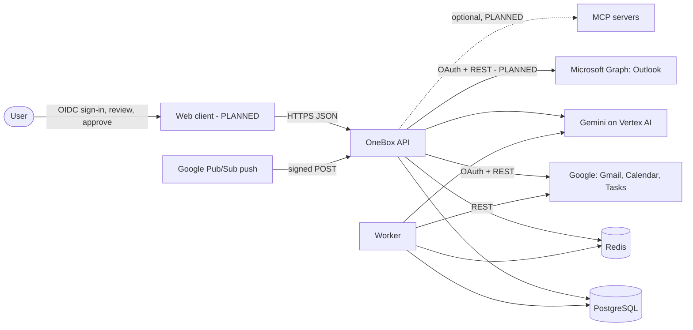
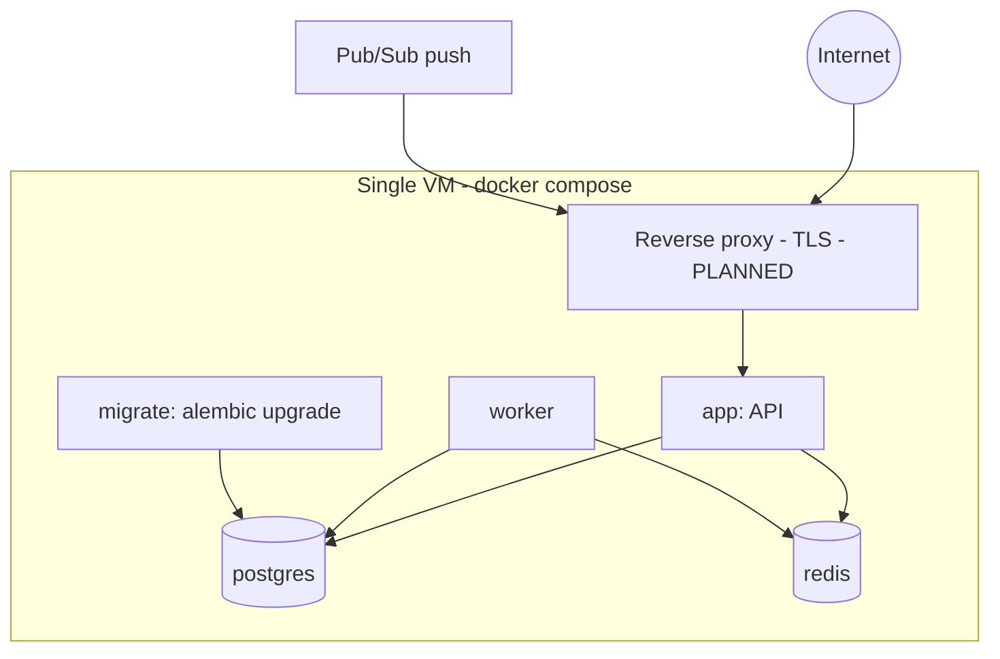
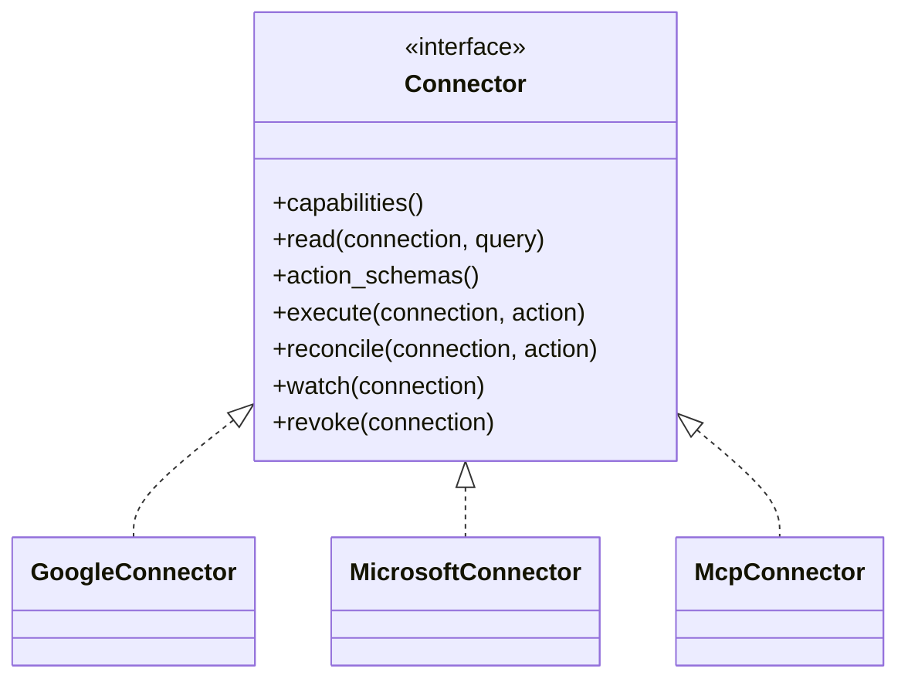
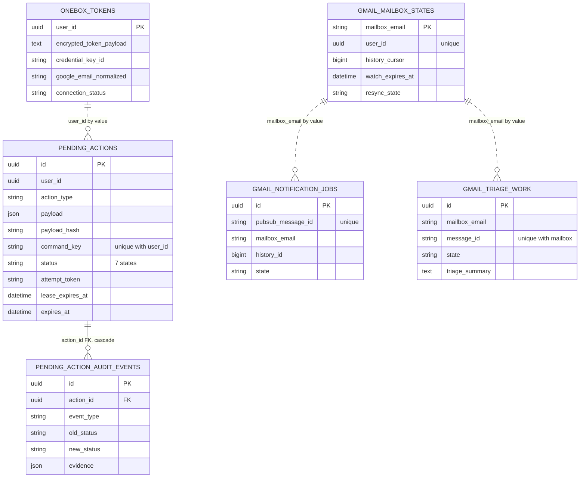
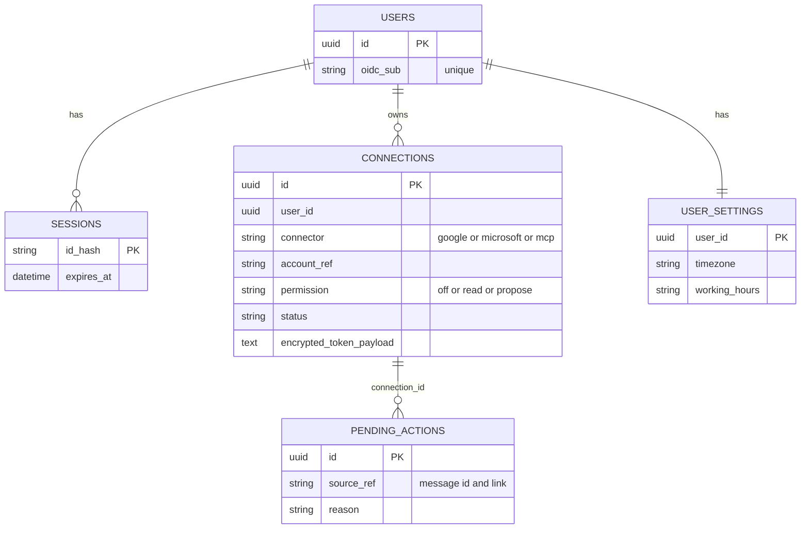
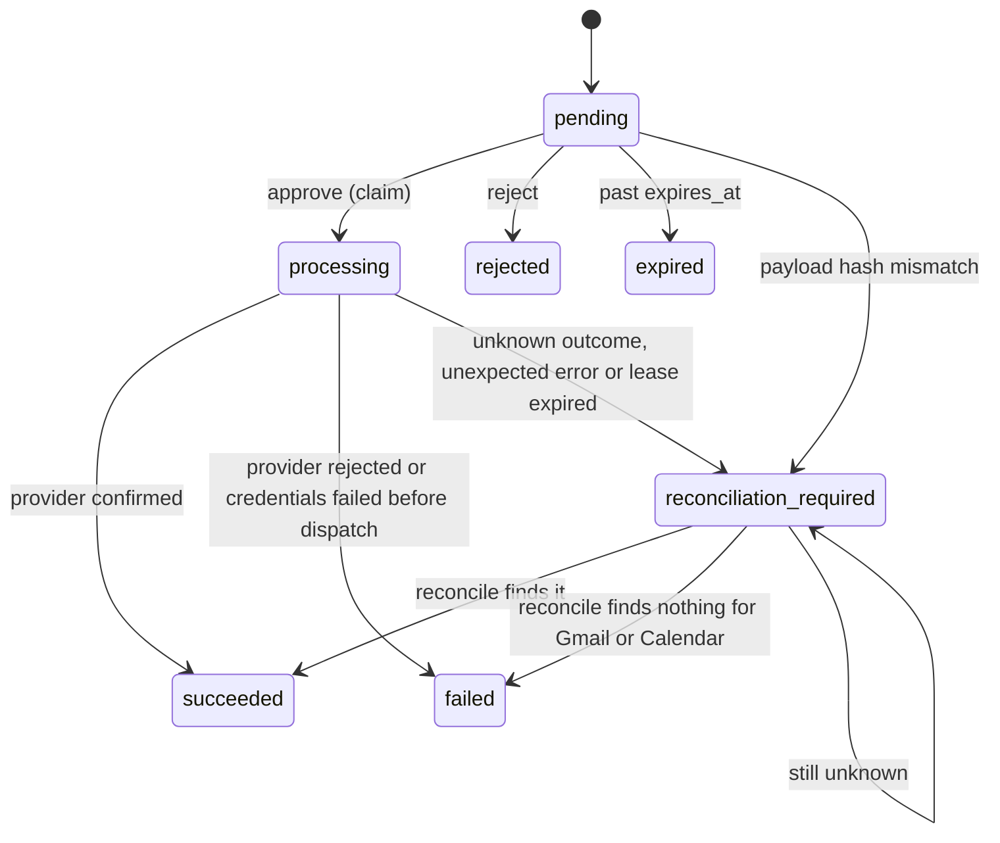
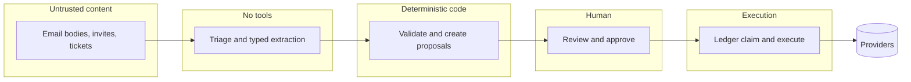

# OneBox — Architecture

**Status:** living · 2026-11-06 · baseline commit `55b6dbd`. Diagrams use Mermaid (GitHub renders them).
**Legend:** **[BUILT]** verified in code · **[PLANNED]** decided, not built · **[ESTIMATE]** judgment or arithmetic.

## 1. Context and goals

Goal: let **one AI assistant** work across a person's tools while **never acting on its own**. Every write is a stored, immutable proposal in **one queue** with **one audit trail**; approval is enforced in code; an unclear provider outcome is reconciled, never retried blindly.

Non-goals: autonomy, RAG, public launch, a general workflow engine. See [PRD.md](PRD.md) §7.

## 2. System context



## 3. Containers and deployment

| Container | Responsibility | Status |
|---|---|---|
| **API** (FastAPI) | Auth, connections, assistant endpoints, approval API, push receiver, health | BUILT (auth and connections PLANNED) |
| **Worker** | Leases notification jobs, runs triage, renews Gmail watch, resyncs, retention cleanup | BUILT |
| **PostgreSQL 16** | System of record: tokens, proposals, audit, jobs, mailbox state | BUILT |
| **Redis 7** | One-time OAuth state; a cache of parsed mail (lists and searches for 60 seconds, message detail for 300 seconds) and its generation counter | BUILT |
| **Web client** | Digest, suggestions queue, activity, connect/settings | PLANNED |



The compose services as built are `postgres`, `redis`, `migrate`, `app` and `worker`. The proxy and TLS are planned for the demo deploy.

## 4. API surface [BUILT]

34 paths in `docs/openapi.json`. Grouped:

| Group | Endpoints | Notes |
|---|---|---|
| Actions (the ledger) | `GET /actions`, `GET /actions/{id}`, `POST /actions/{id}/approve`, `/reject`, `/reconcile` | Reconcile is operator-only |
| Assistant | `POST /executive/`, `POST /generate-stream/`, `POST /generate-content/` | `/executive/` and `/generate-stream/` have tools: send, reply, event and task become proposals, while `create_draft` and `mark_as_read` (executive only) act immediately. `/generate-content/` has no tools. |
| Google OAuth | `GET /agent/oauth/start`, `/agent/oauth/callback`, `POST /agent/verify_and_create_entry`, `GET /agent/status` | Needs an externally issued JWT today |
| Mail REST | `GET /mail/emails`, `/mail/emails/{id}`, `POST …/read`, `/unread`, `/star`, `/trash`, `/restore`, `DELETE /mail/emails/{id}`, `POST /mail/drafts`, `/mail/send`, `GET /mail/search` | Every write here bypasses the ledger: send, drafts, read, unread, star, trash, restore and delete (see [THREAT_MODEL.md](THREAT_MODEL.md)) |
| Push and automation | `POST /mail/notifications`, `/mail/renew-watch`, `/mail/check-inbox`, `/mail/agent/check-inbox`, `GET /mail/agent/status`, `/mail/agent/health` | Only `/mail/notifications` is signature-checked (Pub/Sub token); the others need the automation owner's JWT. `/mail/check-inbox` is a per-user inbox count, and `/mail/agent/check-inbox` always answers 409. |
| Triage | `GET /mail/triage`, `/mail/triage/{id}` | Owner-scoped |
| Health | `GET /livez`, `/readyz`, `/mail/health`, `GET /` | |

## 5. Component map [BUILT]

| Area | Where | Responsibility |
|---|---|---|
| App, lifespan, error handling, health | `server/main.py` | Wiring, request limits, readiness |
| Routes | `server/routes/` | `agent_router.py` (assistant and actions), `agent_oauth.py`, `google_mail.py`, `push_router.py`, `triage.py` |
| Ledger | `server/services/pending_actions.py` | Create, claim, execute, finalize, reconcile, expire, list |
| Provider writes and lookups | `server/services/action_handlers.py` | Gmail, Calendar and Tasks writes; deterministic IDs and markers; reconciliation lookups |
| Automation | `server/services/notification_jobs.py`, `server/workers/` | Job queue with leases, triage, watch renewal, resync |
| Tool policy | `server/agent_policy.py`, `server/agent_tools.py` | Per-run tool allowlists and mutation budget; the tool registry |
| Credentials | `server/services/credentials.py`, `server/security/` | Scopes; encrypted token codec with a keyring |
| Inbound mail | `server/mail/` | Bounded MIME parsing; skip filter |
| Integrations | `server/integrations/` | Google client, LLM adapter, Redis adapter |
| Agent runtime | `agents.py`, `clients/prompt.py`, `tools/` | Prompts; tool callables (send, reply, event and task create proposals; draft and mark-as-read act immediately) |
| Schema | `alembic/versions/` | Migrations |
| Typed client | `frontend-client-types.ts` | API types for a client |

## 6. Connector contract [PLANNED]

Each app is a **connector** behind one interface. A user's authorization for it is a **connection** with its own token and **switch**. Which apps are planned, and the steps to add one, are in [CONNECTORS.md](CONNECTORS.md).



Rules:

1. **Read** methods run only if the switch is Read or Propose. **Writes** exist only as `action_schemas()`: typed payloads that become proposals. No connector method writes outside `execute()`, and `execute()` is called only by the ledger after approval.
2. `execute()` must end in one of three outcomes: **confirmed success**, **confirmed rejection**, or **unknown** (raise `AmbiguousActionOutcome`). Unknown is never retried.
3. `reconcile()` is a read-only lookup that decides whether an unknown write landed. Google has strong lookups (Gmail Message-ID marker search, deterministic Calendar event ID, Tasks marker). A generic MCP connector has none, so its unknown outcomes stay *needs checking*.
4. **Switch semantics:** Off = the token is not used (only Disconnect removes it); Read = read tools only; Propose = read plus proposals. Enforced by the tool allowlist and re-checked when an approved action is claimed; narrower scopes are requested where the provider allows (see [ADR-0005](DECISIONS/ADR-0005-permission-switches.md) and the spike on `include_granted_scopes`).
5. **MCP connector:** write tools are always wrapped as proposals, tool annotations such as `readOnlyHint` are untrusted hints, and OneBox keeps its own allowlist. See ADR-0003.
6. **Approval tier:** every action schema declares a tier from A to D ([ADR-0013](DECISIONS/ADR-0013-approval-tiers.md)). A runs at once and is audited; B and C are proposals, and C is never batched; D is not offered. A schema with no tier is treated as C, and the model cannot set a tier.

## 7. Data model

### As built [BUILT]



Only the audit table has a real foreign key; the rest link by matching values. A legacy plaintext `token_json` column still exists for a dual-read migration; see [THREAT_MODEL.md](THREAT_MODEL.md).

### Target additions [PLANNED]



`onebox_tokens` evolves into `connections` (many per user). `pending_actions` gains `connection_id`, `source_ref` and `reason`. `gmail_triage_work`, `gmail_notification_jobs` and `gmail_mailbox_states` gain a `connection_id`, and the audit table stops cascading with its action and keeps only ids, hashes and states ([ADR-0012](DECISIONS/ADR-0012-data-lifecycle.md)). The exact schema is fixed in TASKS 2.3 and 2.6.

**What "delete my data" removes** (planned, task 2.6):

| Data store | Removed on disconnect | Removed on delete-my-data | Notes |
|---|---|---|---|
| Tokens | yes | yes | Revoked at the provider first |
| Triage summaries and reader output | yes | yes | |
| Notification jobs and mailbox state | yes | yes | |
| Cached mail (Redis) | yes | yes | Also expires in 5 minutes |
| Proposals | kept until retention | yes | Payloads hold message text |
| Audit rows | kept (ids, hashes, states) | kept for the documented period | No content; no cascade |
| Message tombstones | kept 90 days | kept 90 days | Provider ids only |

## 8. Key flows

### 8.1 Sign-in and adding an app [PLANNED]

```mermaid
sequenceDiagram
  participant U as User
  participant W as Web client
  participant A as API
  participant G as Google
  U->>W: Sign in with Google
  W->>A: start OIDC (state, nonce, PKCE)
  A->>G: authorize (openid email profile)
  G-->>A: code
  A->>G: token exchange; validate ID token (iss, aud, exp, nonce)
  A-->>W: opaque server-side session; user keyed by sub
  U->>W: click + and choose Google Calendar
  W->>A: start consent for calendar scope only
  A->>G: authorize (incremental authorization)
  G-->>A: code and refresh token
  A->>A: encrypt token (AES-GCM, per-user context); store connection with switch
```

The OAuth state stores a hash of the session and a PKCE verifier, and the callback requires that same live session ([ADR-0011](DECISIONS/ADR-0011-identity-and-oauth-hardening.md)).

### 8.2 New mail to proposals [triage BUILT; bridge PLANNED]

```mermaid
sequenceDiagram
  participant G as Gmail
  participant P as Pub/Sub
  participant A as API push endpoint
  participant D as Postgres
  participant W as Worker
  participant L as Gemini, no tools
  G->>P: new message
  P->>A: signed push (message id, history id)
  A->>D: insert notification job, dedupe by Pub/Sub message id
  A-->>P: 2xx only after the durable insert
  W->>D: lease job; read mailbox cursor
  W->>G: history.list, messages.get
  W->>D: claim triage work (unique mailbox and message)
  W->>L: email as untrusted data; typed output [PLANNED]
  L-->>W: summary and suggestions
  W->>W: validate: recipient and attendees are the verified sender only, local-day free/busy, daily cap [PLANNED]
  W->>D: save summary; create proposals with source link [PLANNED]
```

### 8.3 Approve and execute [BUILT]

```mermaid
sequenceDiagram
  participant U as User
  participant A as API
  participant D as Postgres
  participant C as Connector
  participant X as Provider
  U->>A: POST /actions/{id}/approve
  A->>D: SELECT FOR UPDATE; check owner, status, expiry, payload hash
  A->>D: status processing, attempt token, lease; COMMIT before any external call
  A->>C: execute(action)
  C->>X: write with deterministic ID or marker
  alt confirmed
    A->>D: succeeded and audit event
  else confirmed rejection
    A->>D: failed and audit event
  else unknown outcome
    A->>D: reconciliation_required and audit event
  end
  A-->>U: action state
```

Planned changes to this flow ([ADR-0010](DECISIONS/ADR-0010-approval-and-execution-protocol.md)): the approve request carries the payload hash the user saw; the claim rechecks the connection, the Propose switch and the sending account; editing a proposal atomically rejects the original; and a confirmed result is accepted after the lease expired when the attempt token still matches.

### 8.4 Unknown outcome and reconcile [BUILT]

An operator calls `POST /actions/{id}/reconcile`. A read-only lookup (Gmail marker search, Calendar event get, Tasks marker scan) moves the action to `succeeded`, `failed`, or leaves it `reconciliation_required` with fresh evidence. An expired-lease `processing` action is promoted to `reconciliation_required` on the next approve attempt or reconcile call. **Gaps:** nothing promotes it automatically yet (TASKS 0.4), and a Gmail lookup that finds nothing returns `failed` at once, although the write may land late or hide in spam or trash. Planned (ADR-0010, TASKS 0.13): no `failed` within 10 minutes of the attempt, spam and trash included, and a read-only reconcile that owners can run on their own action.

### 8.5 Disconnect [PLANNED]

Revoke the token at the provider; delete the connection, its tokens, summaries, jobs and cached data; keep only content-free audit rows under the retention in [ADR-0012](DECISIONS/ADR-0012-data-lifecycle.md); confirm in the timeline.

## 9. State machines

### Pending action [BUILT]



### Background work [BUILT, retry edges simplified]

`gmail_notification_jobs`: `pending → processing → succeeded`. After `GMAIL_NOTIFICATION_MAX_ATTEMPTS` (default 5) a job returns to `pending` and the mailbox enters a bounded resync; a job reaches `dead_letter` only when that resync hits its cap (`GMAIL_RESYNC_MAX_MESSAGES`, default 100), the mailbox state is missing, or a worker dead-letters it. `gmail_triage_work`: `processing → succeeded | noop | dead_letter`. Both use leases (the job lease is 120 seconds) and `next_attempt_at` for backoff. Tasks that find nothing during reconcile stay `reconciliation_required`. Known gap: triage retries are not capped (TASKS 0.3).

## 10. Security architecture



The model that reads untrusted content has **no tools** [BUILT for triage]. Plain code turning its output into proposals is [PLANNED]. A person approves, and the ledger executes agent-initiated writes; the REST mail endpoints in §4 still write directly until TASKS 0.6. Details, breach scenarios and controls: [THREAT_MODEL.md](THREAT_MODEL.md).

## 11. Reliability and failure modes

| Failure | Behavior |
|---|---|
| Process dies after the provider accepted a write | Row stays `processing`; lease expires; promoted to `reconciliation_required` on next touch; automatic sweep PLANNED |
| Provider timeout or lost response | `AmbiguousActionOutcome`; never retried; reconcile |
| Duplicate Pub/Sub delivery | Unique `pubsub_message_id`; ignored |
| Two workers, same message | Lease plus unique `(mailbox, message)` row |
| Gemini unavailable or slow | Triage work released with backoff; interactive call returns a provider error |
| Redis down | Cache treated as miss; OAuth state flow fails closed |
| Retention cleanup raises | Today the loop survives (it logs and retries), but cleanup runs before the heartbeat, watch renewal and job claim, so a persistent failure claims no work and `/readyz` reports the worker stale (TASKS 0.2). Target: cleanup isolated from the loop |
| Gmail watch expires | Renewed by worker; resync on stale history id |

## 12. Capacity and cost estimate

All figures are [ESTIMATE] unless a source is named; assumptions are stated so they can be checked. Quotas and prices below were re-checked against the vendors' own pages on 2026-11-07 ([RESEARCH_EVIDENCE.md](RESEARCH_EVIDENCE.md) §5 and §9.1).

- **Demo scale:** at most 100 allowlisted users (Google Testing-mode cap, official docs).
- **Mail volume:** assume 5–10 active users × 50 mails/day ≈ 250–500 mails/day ≈ well under 1 mail/s even at 10× peak.
- **Model cost:** assume about 4,000 input and 300 output tokens per triage call. The configured model, `gemini-3.5-flash-lite`, costs $0.30 and $2.50 per million input and output tokens on Vertex's global endpoint and $0.33 and $2.75 on regional endpoints such as `us-central1`, which `.env.example` uses (Vertex pricing page, checked 2026-11-07). That is **$1.95 to $2.15 per 1,000 mails** (thinking tokens, if any, bill as output), so roughly **$1 per day** at 500 mails/day. A per-user daily cap bounds the worst case.
- **Gmail quota (official):** 6,000 units per minute per user; `messages.send` costs 100 units; consumer accounts are blocked for 1 to 24 hours after more than 500 recipients in one email or more than 500 emails in a day (Google does not say whether API sends count). Not a constraint at demo scale.
- **Calendar:** 600 requests per minute per user. **Tasks:** 50,000 requests per day. **Graph (Outlook):** 10,000 requests per 10 minutes per mailbox, 4 concurrent.
- **Gmail push:** at most 1 notification per second per user; `watch` must be renewed at least every 7 days (daily recommended).
- **Automation fairness [PLANNED, TASKS 2.5]:** a job covers at most 10 messages and renews its lease per message (today a job holds a 120-second lease and up to 100 messages); work is scheduled round-robin across connections so one flood cannot starve the rest; push for a disconnected mailbox returns 2xx and queues a resync, so Pub/Sub does not retry forever.
- **Cost and rate caps [PLANNED, TASKS 6.3]:** per-user counters live in Postgres and fail closed to a visible `deferred` state, so an exhausted cap never silently drops mail or advances the cursor.
- **Hosting:** a single VM at $6 (1 GiB) or $12 (2 GiB) per month, plus managed PostgreSQL from about $15 per month, so about $21 with the small VM and about $27 with the larger (one provider's own price pages, checked 2026-11-07).

## 13. Observability

[BUILT] `/livez`, `/readyz`, correlation id binding. [PLANNED] one structured log line per model call (model, tokens, latency, finish reason, estimated cost, correlation id equal to the action id); alerts on health, oldest pending notification job, `reconciliation_required` older than N minutes, and daily spend. No tokens or mail bodies in logs: a redaction filter exists today and the canary test is PLANNED (invariant 11).

## 14. Trade-offs

| Decision | Solves | Worsens | Revisit when | ADR |
|---|---|---|---|---|
| Approval enforced in code | Prompt tricks cannot cause a write | A person must review | A written, tested exception for one reversible action; never for sends | [0001](DECISIONS/ADR-0001-approve-first.md) |
| Own Postgres ledger | Full control; small | Must maintain it | A second executing instance, or multi-step flows with timers | [0002](DECISIONS/ADR-0002-own-ledger.md) |
| Native connectors, MCP for the generic path | Real reconciliation where it matters | Slow to add apps | A third connector is requested | [0003](DECISIONS/ADR-0003-native-connectors-mcp-generic.md) |
| OIDC separate from per-app consent | Least privilege; clear UX | More consent steps | Never | [0004](DECISIONS/ADR-0004-oidc-vs-app-consent.md) |
| Off/Read/Propose switches | Simple, enforceable | Coarse | Per-tool control is requested | [0005](DECISIONS/ADR-0005-permission-switches.md) |
| Encrypted refresh tokens | Background triage works | Tokens are a target | A KMS is available | [0006](DECISIONS/ADR-0006-token-storage.md) |
| Reader has no tools | Injection cannot act | Less flexible | A documented incident, or a tool-enabled run must read untrusted content | [0007](DECISIONS/ADR-0007-zero-tool-reader.md) |
| Scope boundaries and freeze rule | A finishable scope | Less breadth | Phase 6 is done and a measured need exists | [0008](DECISIONS/ADR-0008-scope-boundaries.md) |
| Testing mode plus demo mode | Safe demonstration | Weekly re-consent | A real multi-user service is intended | [0009](DECISIONS/ADR-0009-demo-strategy.md) |
| Hash-bound approval; reconcile quiet period | No stale or early-failed writes | More fields, states and tests | A provider offers send idempotency keys | [0010](DECISIONS/ADR-0010-approval-and-execution-protocol.md) |
| Session-bound OAuth; own sessions | No forwarded-link account linking | More code than a library flow | A managed auth provider is adopted | [0011](DECISIONS/ADR-0011-identity-and-oauth-hardening.md) |
| Connection-scoped data; tombstones | Real deletion; no re-proposals | Migration work | Scale beyond the demo | [0012](DECISIONS/ADR-0012-data-lifecycle.md) |
| Approval tiers by reversibility | Approval effort goes where a mistake cannot be undone | A second concept to explain | A user test shows people skip the details on tier C | [0013](DECISIONS/ADR-0013-approval-tiers.md) |

## 15. Open design questions

See [PRD.md §9](PRD.md#9-open-questions) and the spikes in [TASKS.md](TASKS.md) (2.1 and 5.0).
