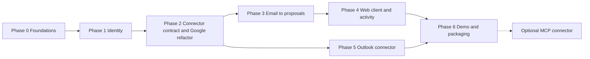

# OneBox — Roadmap

**Status:** living · 2026-11-06 · all durations are [ESTIMATE] for one developer, in working days.
**Freeze rule:** nothing enters this roadmap unless it **fixes a documented failure in the email-to-action loop** and **has a test**. New ideas go to the parking list in §9.

**Totals:** Google loop (phases 0–4 and 6): about 23–37 days, roughly 5–7 weeks. With Outlook (phase 5): about 38–62 days, roughly 8–12 weeks.
**Working method:** every step is test-first (see [TEST_STRATEGY.md](TEST_STRATEGY.md)), one commit per step, conventional commits, never push without the owner's approval. Where a step lands follows [ENGINEERING_PRACTICES.md](ENGINEERING_PRACTICES.md) §3 (owner decision, 2026-11-06): **minor steps are committed directly on `main`; major steps get a branch with a plain name (never `claude/`) and are reviewed before merging.** The default for each step is in the table below. Each step's exit criteria must be shown by a command or a test, not by assertion.

### Where each step lands (default; when unsure, use a branch)

| Step or phase | Lands on | Branch name |
|---|---|---|
| 0.1 | `main` | — |
| 0.2, 0.3 (small bug fixes with tests) | `main` | — |
| 0.4 (ledger state change) | branch | `fix/stuck-action-sweep` |
| 0.5 (API error contract and client types) | branch | `refactor/error-envelope` |
| 0.6 (removes endpoints and a scope) | branch | `fix/remove-ledger-bypasses` |
| 0.7 | `main` for README fixes and dead-code removal; branch if the NULL handling needs a migration | `fix/json-null-handling` |
| Phase 1 | branch | `feat/identity` |
| Phase 2 | branch | `feat/connector-contract` |
| Phase 3 | branch | `feat/email-to-proposals` |
| Phase 4 | branch | `feat/web-client` |
| Phase 5 | branch | `feat/outlook-connector` |
| Phase 6 | branch | `feat/demo-and-packaging` |
| Optional MCP connector | branch | `feat/mcp-connector` |

## Phase 0 — Foundations and audit fixes (1–2 days) · milestone M0

| Step | Task | Test first | Exit criteria |
|---|---|---|---|
| 0.1 | Confirm local `main` is in sync with `origin/main` and the tree is clean | — | `git status` clean; baseline suite green |
| 0.2 | Isolate retention-cleanup failure so the worker loop continues (a failing cleanup currently also skips the heartbeat and the job claim) | Cleanup raises → loop keeps processing jobs and keeps its heartbeat | Test red then green |
| 0.3 | Cap triage retries using the existing `attempt_count` | Poison message stops after N attempts → `dead_letter` | Test red then green |
| 0.4 | Automatic sweep: expired-lease `processing` → `reconciliation_required` with an audit event | Crash-point test: row stuck past lease is promoted | Test red then green; alert metric defined |
| 0.5 | Error envelope with field-level validation details and stable codes; fix the typed client's error type | Invalid `status` returns the offending field | Contract test; `scripts/generate_openapi.py --check` passes |
| 0.6 | Remove `DELETE /mail/emails/{id}` and the broad `mail.google.com` scope after confirming `gmail.modify` suffices; route or remove REST send and trash; dedupe repeated route error handling | Ledger-bypass test: no external write outside the ledger | Invariant 1 test green |
| 0.7 | Drop subject-keyword skipping; store JSON null as SQL NULL (`token_json`); remove dead code; fix README claims (no "exactly once", no "search messages") | Subject "Congrats on your promotion" is triaged; `IS NULL` check finds credential-less rows | Tests green; README reviewed against [THREAT_MODEL.md](THREAT_MODEL.md) §8 |

**Cut line:** none; this phase is the base.

## Phase 1 — Identity (3–5 days) · milestone M1 (part 1)

| Step | Task | Test first | Exit criteria |
|---|---|---|---|
| 1.1 | OpenID Connect sign-in: state, nonce, PKCE; validate ID token (iss, aud, exp, nonce); key users by `sub` | Tampered nonce or wrong audience is rejected | Invalid tokens rejected in tests |
| 1.2 | Opaque server-side sessions with short lifetime; CSRF and Origin checks; replace the external-JWT dependency | Expired or forged session returns 401; cross-origin POST rejected | Tests green; old JWT path removed or flagged for demo only |
| 1.3 | `users` and `user_settings` (time zone, working hours) | Settings isolated per user | Cross-user test green |
| 1.4 | Demo login (no Google) for demo mode | Demo user cannot reach real connections | Test green |

## Phase 2 — Connector contract and Google refactor (3–5 days, plus spikes 1–2) · M1 (part 2)

| Step | Task | Test first | Exit criteria |
|---|---|---|---|
| 2.1 | Spikes on a throwaway account: Gmail Message-ID survival on send; `include_granted_scopes` versus scope tiering; Tasks scope tier | Written result recorded in an ADR note | Findings in [PRD.md](PRD.md) §9 closed |
| 2.2 | Define the connector contract; implement `GoogleConnector` over the existing handlers | Contract tests every connector must pass | Existing suite stays green |
| 2.3 | `connections` with Off / Read / Propose; token encrypted per connection; "+" flow with incremental consent | Switch Off blocks all token use; Read blocks proposals | Policy tests green |
| 2.4 | Disconnect: revoke at the provider, delete tokens, confirm | Revoke endpoint called; row gone; later calls fail closed | Invariant 13 test green |
| 2.5 | Automation for every connection (per-connection watch, cursor, resync) instead of one configured mailbox | Two mailboxes processed independently | Isolation test green |

**Cut line:** if time is short, keep one Google connection per user.

## Phase 3 — Email to proposals (5–8 days) · M2 (part 1)

| Step | Task | Test first | Exit criteria |
|---|---|---|---|
| 3.1 | Typed triage output (summary plus suggestions) from the zero-tool reader | Output schema violations are rejected | Parser tests green |
| 3.2 | Deterministic validator: recipient is the verified sender only (today `resolve_reply_target` prefers `Reply-To`); local-day free/busy; daily cap; dedupe by message and type | Reply-To and Cc never become recipients; DST-boundary table; cap enforced | Invariants 8 and 9 green |
| 3.3 | Create proposals with source link and short reason; idempotent per message and suggestion | Re-triaging the same mail creates no duplicates | Idempotency test green |
| 3.4 | Honest status: assistant text never claims success unless confirmed | Pending action → reply says "waiting for your approval" | Invariant 10 green |
| 3.5 | Fault-injection tests with a wrapper around the provider HTTP layer (lost response after acceptance) | Duplicate effects are zero per action type | Invariant 4 and M2 green |

## Phase 4 — Web client and activity (8–12 days) · M2 (part 2)

| Step | Task | Exit criteria |
|---|---|---|
| 4.1 | Four screens: digest, suggestions queue, activity, connect and settings; plain-text rendering only | A first-time viewer completes review-and-approve (observation) |
| 4.2 | API additions: activity timeline endpoint; edit-before-approve (creates a new proposal) | Contract tests; OpenAPI regenerated |
| 4.3 | Conflict warning on event cards; "needs checking" state with resolve action | UI test against fixture proposals |

Default stack: Vite, React and TypeScript with an off-the-shelf component library, using `frontend-client-types.ts` as the typed client. [OPEN until this phase starts]
**Cut line:** drop the optional "Today" panel first, then edit-before-approve, then activity polish.

## Phase 5 — Outlook connector (15–25 days) · M3

| Step | Task | Exit criteria |
|---|---|---|
| 5.1 | Graph OAuth for a personal account; read mail | Connection works on a test account |
| 5.2 | Send and reply with reconciliation through Sent Items; create event using the event `transactionId` | Contract tests pass; lost-response test shows *needs checking* where the lookup is weak |
| 5.3 | Polling for new items first (webhooks later) | New Outlook mail yields suggestions |
| 5.4 | Cross-provider demo: Outlook mail → Google Calendar event, approved once | Scripted run passes (M5) |

**Cut line:** this phase is optional. Without it, the Google loop is a complete project.

## Phase 6 — Demo and packaging (3–5 days) · M4

Demo mode (synthetic mailbox, canned model output, fake providers; no sign-in); single-VM deploy with TLS and health checks; three alerts (health, oldest pending job, `reconciliation_required` older than N minutes) plus a spend alert; 90-second video; README with diagram; ADRs finalized. **Exit:** a stranger follows the README to a running demo.

## Optional — MCP connector (5–8 days)

A generic connector for one app with an official MCP server (Jira or Notion), writes wrapped as proposals, unknown outcomes shown as *needs checking*. Only after phases 0–6.

## 9. Parking list (frozen)

Chat UI, notifications, voice, inbox search, meeting notes, scheduling links, follow-up reminders, writing in the user's voice, Zoho, passkey-signed approvals, an approver study, RAG, eval harness, Google verification.

## 10. Risks that can move the dates

Frontend effort (largest unknown); Outlook reconciliation behavior; weekly token expiry in Testing mode; scope tiering conflict with Google's grant merging (spike 2.1).
