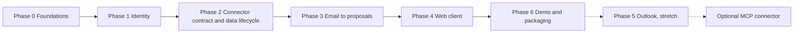

# OneBox — Roadmap

**Status:** living · 2026-11-06 · all durations are [ESTIMATE] for one developer, in working days, summed from the task sizes in [TASKS.md](TASKS.md).
**What this file is:** the order of the phases, the totals, the cut lines and the freeze rule. **Every task** (dependencies, branch, done-when, commit plan) is in [TASKS.md](TASKS.md); this file does not repeat it.

## Freeze rule

Nothing enters this roadmap unless it **fixes a documented failure in the email-to-action loop and has a test**, or it is an **owner-approved milestone** ([ADR-0008](DECISIONS/ADR-0008-scope-boundaries.md)). Outlook is such a milestone and is a stretch. Which further apps may follow, and how one is added, is in [CONNECTORS.md](CONNECTORS.md). New ideas go to the parking list below.

## Phases, milestones and estimates

| Phase | Outcome | Milestone | Tasks | Days [ESTIMATE] | Branch |
|---|---|---|---|---|---|
| 0 Foundations | Audit bugs fixed; every write goes through the ledger; CI covers branches | MS0 | 0.1–0.13 | 9–18 | mostly `main`; three plain branches |
| 1 Identity | Sign-in with Google; opaque sessions | MS1 | 1.1–1.3 | 3–7 | `feat/identity` |
| 2 Connector contract and data lifecycle | Connections, Off/Read/Propose, disconnect, deletion | MS1 | 2.1–2.6 | 8–15 | `feat/connector-contract` |
| 3 Email to proposals | New mail becomes validated suggestions, checked against the golden set | MS2 | 3.1–3.7 | 6–13 | `feat/email-to-proposals` |
| 4 Web client | Four screens; review and approve in a browser; the thesis is tested on real people | MS2 | 4.0–4.3 and 4.5 (4.4 is optional and not counted) | 6–12 | `feat/web-client` |
| 6 Demo and packaging | A stranger runs the demo from the README | MS4 | 6.1–6.4 | 4–8 | `feat/demo-and-packaging` |
| **Google loop** | **Phases 0–4 and 6** | | | **36–73 (7–15 weeks at 30 hours a week; plan on about 11)** | |
| 5 Outlook (stretch) | Second provider; cross-provider demo | MS3 | 5.0–5.4 | 13–22 | `feat/outlook-connector` |
| **With Outlook** | | | | **49–95 (10–19 weeks at 30 hours a week; plan on about 14)** | |

Why these totals are higher than the first draft (5–7 and 8–12 weeks): the review found work the first plan lacked. That work is 0.10–0.13 (CI on branches, push tests, shared fakes, reconcile quiet period), the whole of 2.6 (data lifecycle), 3.6 (tombstones), the golden set (3.7), the hash-bound approval in 4.1, the user observation (4.5), and the XL size of the Outlook tasks. The numbers do not include provider surprises, review rounds or learning a new toolchain. Treat the low end as a best case.

## From days to calendar time

The totals above are **focused working days**. One day is taken as 6 hours of real project work; the rest goes to review waits, interruptions and context switching. So the Google loop is about 216–438 hours and the Outlook stretch brings it to about 294–570 hours. The weeks below are those hours divided by the hours per week you can really give [ESTIMATE]. They do not include holidays, long review waits or a second round of rework.

| Hours per week | Google loop (weeks) | With Outlook (weeks) |
|---|---|---|
| 10 | 22–44 | 29–57 |
| 15 | 14–29 | 20–38 |
| 20 | 11–22 | 15–29 |
| 30 | 7–15 | 10–19 |
| 40 | 5–11 | 7–14 |

**Your weekly hours: [OPEN].** Replace this line with your number; the matching row is then the plan.

**Recalibrate after every phase.** Divide the days a phase really took by the midpoint of its estimate, and multiply the remaining phases by that ratio. If Phase 0 takes 20 days against a midpoint of 13.5, expect the rest to run about 1.5 times longer, and cut from the order of sacrifice below before the dates slip.

## Working method

Every task is test-first ([TEST_STRATEGY.md](TEST_STRATEGY.md)), split into the commits listed in [TASKS.md](TASKS.md), committed with conventional messages and never pushed without the owner's approval. Where a task lands follows [ENGINEERING_PRACTICES.md](ENGINEERING_PRACTICES.md) §3: **minor tasks go straight to `main`; major tasks get a plainly named branch (never `claude/`) and are reviewed before merging.** A task's exit criteria are shown by a command or a test, not by assertion.

## The demo-critical path

If time runs out, these tasks alone make a convincing demo of the core claim (the AI proposes, a person approves, it runs once, an unclear outcome is flagged, nothing bypasses the queue):

| Task | Why it cannot be dropped |
|---|---|
| 0.1, 0.4, 0.6 | A trustworthy baseline: stuck actions are promoted and no write bypasses the ledger |
| 1.1, 1.2 | Real sign-in and sessions |
| 2.2, 2.3 | The connector contract and the Off/Read/Propose switches ("+") |
| 3.1–3.3, 3.7 | New mail becomes validated proposals, and the golden set defines and seeds what the demo shows |
| 4.0 | At least the suggestions queue, so a person can approve |
| 6.1, 6.4 | A demo a stranger can run, and the README that explains it |

## Order of sacrifice

When the plan slips, cut from the top of this list and stop as soon as it fits:

1. Phase 5 (Outlook) and the optional MCP connector.
2. 4.3 polish, then the activity screen, then the digest screen (keep the suggestions queue and settings).
3. 3.5 fault-injection breadth (keep one action type) and 3.6 bounded resync.
4. 2.5 multi-mailbox fairness (keep one Google connection per user).
5. 0.9 coverage reporting and 0.12 shared fakes.

**Never cut:** 0.4, 0.6, 0.13, 1.1, 1.2, 2.3, 2.4, 2.6, 3.2, 3.7 and 4.5. They are the guarantees the project claims, plus the two cheap checks of whether it is useful and whether people want it. 4.5 may shrink to three people but not disappear.

## Parking list (frozen)

Chat UI, notifications, voice, inbox search, meeting notes, scheduling links, follow-up reminders, writing in the user's voice, Zoho, passkey-signed approvals, an approver study, RAG, an eval harness, Google verification. Simplification candidates S-1 and S-2 are tracked in [TASKS.md](TASKS.md) X.4 and must be decided before the phase that needs them.

## Risks that can move the dates

Frontend effort (the largest unknown, and the reason S-2 exists); Outlook reconciliation behavior; weekly token expiry in Google's Testing mode; the scope-tiering conflict with Google's grant merging (spike 2.1); the data-lifecycle migration (2.6) touching four tables at once.
