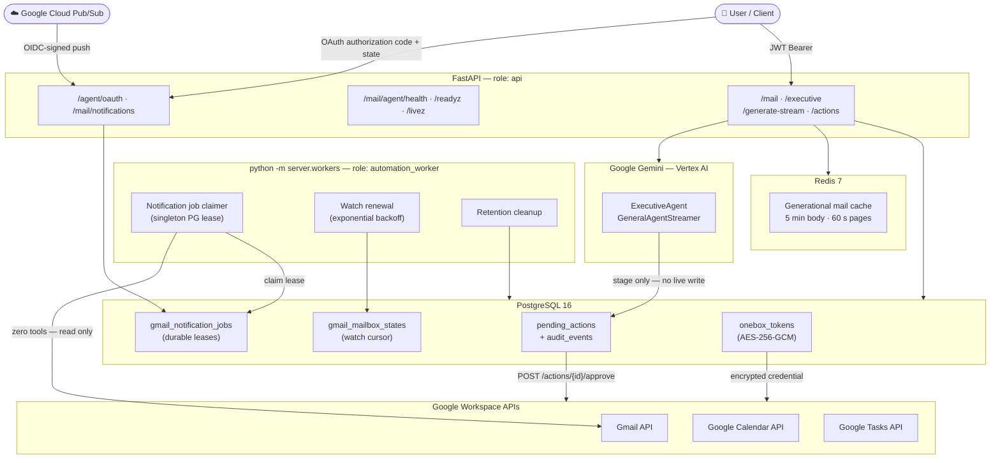

# OneBox

> Production-grade asynchronous AI agent orchestration platform integrating Google Workspace (Gmail, Calendar, Tasks) with Gemini models, durable Pub/Sub workers, and human-in-the-loop action governance.

[](https://www.python.org/)
[](https://fastapi.tiangolo.com/)
[](https://www.postgresql.org/)
[](https://redis.io/)
[](docs/openapi.json)

[Overview](#overview) • [Features](#features) • [Architecture & Roles](#architecture--service-roles) • [Prerequisites](#prerequisites) • [Quick Start](#quick-start) • [Configuration](#configuration-reference) • [API & Event Streams](#api--event-stream-reference) • [Operational Policies](#operational--security-policies) • [Docker Deployment](#docker-deployment) • [Testing & Verification](#testing--release-gates) • [Project Structure](#project-structure)

---

## Overview

Managing high-volume executive communication, meeting scheduling, and task coordination requires continuous context switching and carries high operational risk if automated blindly.

**OneBox** provides a resilient, secure foundation for AI-assisted executive operations. It pairs Google Gemini models with Google Workspace APIs (Gmail, Google Calendar, Google Tasks) while enforcing strict operational boundaries:

1. **Interactive Agent Planning:** Users engage with executive and streaming agents to inspect schedules, search messages, and compose plans. Any external mutation requested through an interactive agent (sending an email, creating a calendar event, adding a task) is staged as an immutable, typed **pending action** requiring explicit user approval.
2. **Durable Inbound Automation:** An asynchronous background worker receives authenticated Google Cloud Pub/Sub push notifications for a configured mailbox, acquiring singleton PostgreSQL leases and recovering message history safely. Inbound automation operates with **zero tool permissions**—it analyzes incoming messages according to user triage rules without autonomously modifying mail or issuing writes.
3. **Enterprise Resilience & Governance:** Built with encrypted OAuth token keyrings, classified provider retry policies, generational Redis caching, and operator reconciliation workflows for uncertain provider writes.

---

## Features

- **Human-in-the-Loop Safeguards:** Agent-initiated external mutations (email sends/replies, calendar events, tasks) are staged as immutable pending actions in PostgreSQL; no agent-driven destructive effect executes without explicit authorization (`POST /actions/{action_id}/approve`).
- **Durable Gmail Pub/Sub Worker:** Scalable background notification daemon with PostgreSQL row-level locks, bounded lease recovery, automatic watch renewal, and safe history resynchronization.
- **Strict Separation of Concerns:** Inbound automated triage is decoupled from interactive agent execution. Automated triage has zero tools, preventing unauthorized automated replies or state changes.
- **Encrypted OAuth Keyring:** User tokens are protected at rest with AES-256-GCM using an active key ID from a mounted, read-only JSON keyring (`OAUTH_TOKEN_KEYRING_PATH`).
- **Classified Provider Retries:** Google API requests are categorized into permanent, authentication, quota, retryable transport/read, and ambiguous write. Ambiguous writes are dispatched once and never blind-retried.
- **Operator Reconciliation Workflow:** Ambiguous external writes enter a `reconciliation_required` state, allowing authorized operators to inspect deterministic provider markers and resolve state safely.
- **Generational Caching:** Redis caching for mail details (5-minute TTL) and folder/search pages (60-second TTL) using atomic per-user generation keys to invalidate stale data without wildcard key scans.
- **Multi-Role Process Topology:** First-class support for separate `api`, `automation_worker`, `migrate`, and local `combined` service roles.
- **Migration-Aware Health Checks:** Dedicated dependency-free `/livez` endpoint alongside `/readyz` that verifies schema migration heads and Redis connectivity without making external Google calls.

---

## Architecture & Service Roles

OneBox isolates API ingress, durable background processing, database migrations, and external provider integrations into distinct, single-responsibility components:



### Supported Process Roles

| Role | Target Command | Primary Responsibilities |
| --- | --- | --- |
| `api` | `uvicorn server.main:app` | Serves REST/SSE routes, authenticates user JWTs, handles OAuth flows, accepts Pub/Sub webhook pushes, and manages pending action approvals. |
| `automation_worker` | `python -m server.workers` | Claims pending notification jobs from PostgreSQL, executes inbox triage with zero tools, renews Gmail push watches, and runs retention cleanups. |
| `combined` | `uvicorn server.main:app` | **Local development only**. Runs API routes and in-process automation worker tasks concurrently. |
| `migrate` | `alembic upgrade head` | One-shot migration container running schema upgrades prior to API or worker boot. |

---

## Prerequisites

- **Python 3.12+**
- **PostgreSQL 16+** (with `pg_isready` support and TLS in staging and production)
- **Redis 7+** (`redis://` for development, authenticated `rediss://` for staging and production)
- **Docker & Docker Compose** (for containerized deployments)
- **Google Cloud Platform Project** with active APIs:
  - Gmail API (`gmail.modify`, `mail.google.com`)
  - Google Calendar API (`calendar`)
  - Google Tasks API (`tasks`)
  - Cloud Pub/Sub API
  - Vertex AI API / Google GenAI API

---

## Quick Start

### 1. Clone Repository & Setup Environment

```bash
git clone https://github.com/HarshilMaks/onebox.git
cd onebox

# Create virtual environment and install verified pinned dependencies
make install
source .venv/bin/activate
```

> [!NOTE]
> `make install` uses `pip install --require-hashes -r requirements-dev.txt` to enforce hash verification across all dependencies.

### 2. Configure Environment

```bash
cp .env.example .env
```

`.env.example` already sets working local values for the JWT issuer/audience, OAuth redirect URIs, Google location and model, and CORS. Every setting without a default must stay present, and unknown names fail startup. Before the first run, change these:
- `DATABASE_URL`: replace `REPLACE_WITH_PASSWORD` with your local PostgreSQL password.
- `SECRET_KEY`: replace the placeholder (which is rejected at startup) with at least 32 bytes, for example `openssl rand -hex 32`.
- `GOOGLE_PROJECT_ID`: your Google Cloud project ID.
- `GOOGLE_OAUTH_CLIENT_SECRETS`: place your OAuth Web Client JSON at `onebox_oauth.json` in the repo root (it is gitignored), or point this at another path.
- `OAUTH_TOKEN_KEYRING_PATH` and `OAUTH_TOKEN_ACTIVE_KEY_ID`: uncomment both. Without them, Google connect and token loading fail closed. Create a local keyring outside version control (all `*.json` files are gitignored):

```bash
python3 -c 'import base64,json,os; print(json.dumps({"local-key-1": base64.urlsafe_b64encode(os.urandom(32)).decode()}))' > onebox-oauth-token-keyring.json
chmod 600 onebox-oauth-token-keyring.json
# then in .env:
# OAUTH_TOKEN_KEYRING_PATH=onebox-oauth-token-keyring.json
# OAUTH_TOKEN_ACTIVE_KEY_ID=local-key-1
```

### 3. Start Local Redis

```bash
bash scripts/redis_setup.sh
```

### 4. Run Database Migrations

```bash
.venv/bin/alembic upgrade head
```

### 5. Launch Application Services

To start the API in development mode with hot reload:

```bash
make run-dev
```

To run the background automation worker:

```bash
make run-worker
```

Interactive OpenAPI documentation is accessible at `http://localhost:8000/docs`.

The agent profile and default timezone live in `user_config.yaml`; see [docs/CONFIGURATION.md](docs/CONFIGURATION.md#agent-profile-user_configyaml).

---

## Configuration Reference

Every setting (name, whether it is required, its default and what it does), the three secret files, and the agent profile are in **[docs/CONFIGURATION.md](docs/CONFIGURATION.md)**.

---

## API & Event Stream Reference

Eight endpoint groups (health, automation diagnostics, the interactive agent, event streaming, approve, reconcile, list actions, triage results) and the pending-action state machine are documented, with examples, in **[docs/API.md](docs/API.md)**. The machine-readable contract is [`docs/openapi.json`](docs/openapi.json).

---

## Operational & Security Policies

Input limits, the generational mail cache, the per-run tool allowlist, provider retry classes, account identity and data retention are described in **[docs/POLICIES.md](docs/POLICIES.md)**.

---

## Docker Deployment

OneBox provides a production-grade multi-container topology via `docker-compose.yaml` consisting of `postgres`, `redis`, a one-shot `migrate` service, the FastAPI `app`, and the background `worker`:

```bash
# Verify Compose configuration syntax
make compose-config

# Launch all services in background
make compose-up
```

Credential and keyring files are mounted read-only from the host into `/run/secrets/`:

```bash
export GOOGLE_OAUTH_CLIENT_SECRETS_HOST_PATH="$PWD/onebox_oauth.json"
export GOOGLE_APPLICATION_CREDENTIALS_HOST_PATH="$PWD/executive-agent.json"
export OAUTH_TOKEN_KEYRING_HOST_PATH="$PWD/onebox-oauth-token-keyring.json"
export OAUTH_TOKEN_ACTIVE_KEY_ID="active-key-id"
export POSTGRES_PASSWORD="secure-postgres-password"
export SECRET_KEY="$(openssl rand -hex 32)"   # at least 32 bytes; shorter keys fail startup
export GOOGLE_PROJECT_ID="your-gcp-project-id"

# The migrate, app, and worker services share the automation settings, so Compose also requires:
export AUTOMATION_OWNER_ID="00000000-0000-0000-0000-000000000000"   # OneBox user UUID
export PUBSUB_TOPIC="projects/your-gcp-project-id/topics/gmail-notifications"
export PUBSUB_SUBSCRIPTION="projects/your-gcp-project-id/subscriptions/gmail-notifications"
export PUBSUB_PUSH_AUDIENCE="https://your-api-host/mail/notifications"
export PUBSUB_PUSH_SERVICE_ACCOUNT_EMAIL="pubsub-push@your-gcp-project-id.iam.gserviceaccount.com"

make compose-up
```

Compose stops with a `Set ... in your local environment` error if any of these variables is missing.

To tail logs from the application and worker:

```bash
docker compose logs -f app worker
```

To gracefully shut down services:

```bash
make compose-down
```

> [!IMPORTANT]
> Detailed procedures for rolling upgrades, safe rollbacks, Gmail watch renewal, and pending-action reconciliation are documented in the [Backend Operations Runbook](docs/OPERATIONS.md).

---

## Testing & Release Gates

All backend changes must pass the automated release gate before deployment:

```bash
# Execute full suite: Ruff linting, OpenAPI drift check, and Pytest
make check
```

Individual developer workflows:

```bash
# Run Ruff lint checks
make lint

# Run Pytest unit and integration test suite
make test

# Regenerate OpenAPI schema contract
make contract

# Verify OpenAPI schema has not drifted
make contract-check

# Verify container security: non-root execution and zero secret leaks
make image-smoke
```

> [!NOTE]
> Tests import the application settings, so `make test` and `make contract-check` need a configured `.env` (or the same variables exported); without one they fail with Pydantic `Field required` errors. CI's test values are in [`.github/workflows/backend.yml`](.github/workflows/backend.yml).
>
> The integration tests in `tests/integration/` connect to the PostgreSQL server from `DATABASE_URL`, create a temporary database per test, and drop it afterwards; the configured user needs `CREATEDB`. If PostgreSQL is not reachable they are **skipped**, not failed, so a green local run without PostgreSQL does not cover them.

---

## Project Structure

```
onebox/
├── agents.py                    # Executive, general, and streaming Gemini agent loops
├── server/
│   ├── main.py                  # FastAPI application entrypoint & lifespan
│   ├── config.py                # Typed settings, validation, and role definitions
│   ├── auth.py                  # Verified JWT principal (user ID, email, frozen claims)
│   ├── oauth_state.py           # One-time OAuth state stored in Redis
│   ├── database.py              # Async SQLAlchemy engine, sessionmaker, and Base
│   ├── models.py                # Database models (Tokens, Actions, Jobs, Watches)
│   ├── schemas.py               # Public request/response models for the OpenAPI contract
│   ├── action_payloads.py       # Strict typed payloads for each pending action type
│   ├── redis_cache.py           # Generational Redis cache client and utilities
│   ├── pagination.py            # Opaque keyset page tokens shared by list endpoints
│   ├── request_limits.py        # Request-body size limit middleware
│   ├── logging_config.py        # Redacting log formatter and correlation IDs
│   ├── agent_policy.py          # Immutable per-run agent authorization policy
│   ├── agent_tools.py           # Gemini function declarations & trusted tool bindings
│   ├── commands/
│   │   └── backfill_oauth_credentials.py # One-off legacy plaintext token encryption
│   ├── security/
│   │   └── oauth_credentials.py # AES-256-GCM OAuth token codec and keyring loader
│   ├── mail/
│   │   ├── mime.py              # Bounded MIME decoding & strict HTML sanitizing
│   │   └── inbound.py           # Inbound message parsing & triage eligibility filter
│   ├── integrations/
│   │   ├── provider.py          # Bounded thread runner for blocking SDK calls
│   │   ├── google.py            # Classified Google API retry & backoff wrapper
│   │   ├── gmail.py             # Gmail request dispatch by safety class & HTTP error mapping
│   │   ├── llm.py               # Gemini (Vertex AI) generate and stream adapter
│   │   └── redis.py             # Redis connection pools and concurrency limits
│   ├── routes/
│   │   ├── agent_oauth.py       # Google OAuth 2.0 authorization-code / state flows
│   │   ├── agent_router.py      # Executive/streaming agents & pending action lifecycle
│   │   ├── google_mail.py       # User mail fetch, search, star, and delete endpoints
│   │   ├── push_router.py       # Authenticated Google Pub/Sub push receiver
│   │   └── triage.py            # Read-only view of the worker's triage results
│   ├── services/
│   │   ├── pending_actions.py   # Pending action staging, claiming, and reconciliation
│   │   ├── action_handlers.py   # Executable handlers for approved pending actions
│   │   ├── notification_jobs.py # Durable notification queue storage & leases
│   │   ├── credentials.py       # OAuth exchange, token storage, refresh, and service building
│   │   ├── mailbox.py           # User-facing mailbox fetch and cache services
│   │   ├── readiness.py         # Migration and persistence health verifiers
│   │   ├── retention.py         # Expires stale proposals and prunes terminal records
│   │   ├── triage_results.py    # Owner-scoped triage result queries
│   │   └── setup_google.py      # Authenticated Google Workspace service factories
│   └── workers/
│       ├── __main__.py          # Worker entrypoint (`python -m server.workers`)
│       └── mail_notifications.py# Durable Pub/Sub notification worker & watch renewal
├── tools/
│   ├── llm_tools.py             # Interactive agent tools & pending action generators
│   ├── idempotency.py           # Canonical payload hashing and command record keys
│   └── utils.py                 # RFC 2822 message encoders and header utilities
├── clients/
│   ├── base.py                  # Base Agent class (injectable Gemini provider)
│   └── prompt.py                # Executive and email agent system prompts
├── tests/
│   ├── unit/                    # Fast isolated unit tests
│   └── integration/             # Database and notification queue integration tests
├── docs/
│   ├── openapi.json             # Generated, backend-owned OpenAPI contract
│   └── OPERATIONS.md            # Production runbook, watch renewal, and recovery
├── alembic/                     # Database migrations
├── scripts/
│   ├── generate_openapi.py      # Tool to generate/check OpenAPI schema drift
│   └── redis_setup.sh           # Local developer Redis provisioning script
├── Dockerfile                   # Multi-stage hardened non-root container image
├── docker-compose.yaml          # Multi-container orchestration (App, Worker, DB, Redis)
├── Makefile                     # Common development, testing, and release targets
└── user_config.yaml             # Agent profile: identity, timezone, and preferences
```

