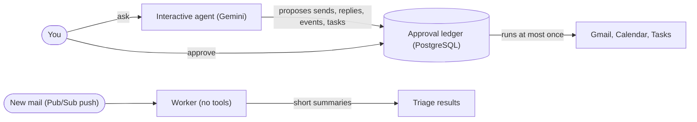

# OneBox

**An approve-first assistant for mail, calendar and tasks.** The AI proposes, a person approves each action, and an approved action runs at most once.

[](https://github.com/HarshilMaks/onebox/actions/workflows/backend.yml)
[](https://www.python.org/)
[](docs/openapi.json)

> **Status:** a working backend, not a finished product. Gmail, Calendar and Tasks actions, the approval ledger, background mail summaries and CI exist and are tested. Sign-in, connecting more apps, suggestions from new mail, a web client and Outlook are planned, not built.

## What it does today

- **Proposes, then waits.** Ask the assistant to send an email, reply, book an event or add a task and it stores a *pending action* instead of doing it. You approve it with `POST /actions/{id}/approve` and it runs at most once. Creating a draft and marking mail as read are the only things it does without asking.
- **Summarizes new mail in the background.** A worker receives Gmail push notifications for one configured mailbox and writes a short summary of each new message with a model that has no tools, so a hostile email cannot make it act. Results are at `GET /mail/triage`.
- **Says so when it is unsure.** If a provider call times out, the action is marked `reconciliation_required` ("needs checking") and is never retried blindly. An operator can look the result up with `POST /actions/{id}/reconcile`.
- **Keeps credentials encrypted.** Google tokens are encrypted at rest (AES-256-GCM) with a key that lives outside the database.

## How it works



An agent never writes to Google itself. It stores a typed proposal; only the ledger executes, and only after you approve.

---

## Quick start

You need Python 3.12 and Docker. Google credentials are only needed for Google features: without them the API still starts, and `/livez`, `/readyz` and `/docs` work.

```bash
git clone https://github.com/HarshilMaks/onebox.git && cd onebox
make install && source .venv/bin/activate     # needs python3.12 on PATH
cp .env.example .env                          # then edit it: see below

docker run -d --name onebox-dev-pg -p 127.0.0.1:5432:5432 \
  -e POSTGRES_DB=onebox -e POSTGRES_USER=onebox -e POSTGRES_PASSWORD=<throwaway-password> postgres:16.6-alpine
docker run -d --name onebox-dev-redis -p 127.0.0.1:6379:6379 redis:7.4.2-alpine
until docker exec onebox-dev-pg pg_isready -U onebox -d onebox; do sleep 1; done

alembic upgrade head
make run-dev                                  # API docs at http://localhost:8000/docs
```

In `.env`, put the same password into `DATABASE_URL` and set `SECRET_KEY` to a random value of at least 32 bytes (for example `openssl rand -hex 32`). Google features also need an OAuth client file and a token keyring: see the [development guide](docs/DEVELOPMENT.md#3-configure-the-environment).

## Try it

There is no sign-in screen yet, so a developer signs a short-lived token with the app's own secret:

```bash
TOKEN=$(python - <<'EOF'
import time, uuid
from jose import jwt
from server.config import settings
print(jwt.encode({"sub": str(uuid.uuid4()), "email": "dev@example.test", "iss": settings.JWT_ISSUER, "aud": settings.JWT_AUDIENCE, "exp": int(time.time()) + 3600}, settings.SECRET_KEY, algorithm=settings.ALGORITHM))
EOF
)
curl -s -H "Authorization: Bearer $TOKEN" "localhost:8000/actions?status=pending"
# {"actions":[],"next_page_token":null}   (nothing is pending yet; without the header you get 401)
```

The agent and mail endpoints additionally need real Google credentials and a connected account (`GET /agent/oauth/start`). Request and response examples for every endpoint are in [docs/API.md](docs/API.md).

## Safety, and what is not guaranteed yet

What you can rely on:

- The assistant cannot send, reply, book an event or create a task on its own; a person approves each one.
- A write is dispatched at most once. An unclear outcome is checked against the provider, never retried blindly.
- OneBox never sees your password and keeps no chat memory. Tokens are encrypted. Proposals, summaries and audit events are stored as plain text with a retention limit (finished proposals 30 days, jobs and summaries 14), and parsed mail is cached in Redis for up to 5 minutes.

What is not true yet:

- The direct mail endpoints (`/mail/send`, delete, trash) act as the signed-in user and do not go through the approval ledger. Routing or removing them is the first planned task.
- A stuck `processing` action becomes "needs checking" only when something touches it; there is no automatic sweep.
- Nothing here is claimed to be "exactly once", "zero retention" or "cannot be tricked". The threat model lists the gaps: [.lock/THREAT_MODEL.md](.lock/THREAT_MODEL.md).

---

## Configuration Reference

Every setting (name, whether it is required, its default and what it does), the three secret files, and the agent profile are in **[docs/CONFIGURATION.md](docs/CONFIGURATION.md)**.

---

## API & Event Stream Reference

Eight endpoint groups (health, automation diagnostics, the interactive agent, event streaming, approve, reconcile, list actions, triage results) and the pending-action state machine are documented, with examples, in **[docs/API.md](docs/API.md)**. The machine-readable contract is [`docs/openapi.json`](docs/openapi.json).

---

## Operational & Security Policies

Input limits, the generational mail cache, the per-run tool allowlist, provider retry classes, account identity and data retention are described in **[docs/POLICIES.md](docs/POLICIES.md)**.

---

## Docker Deployment

The Compose topology (`postgres`, `redis`, a one-shot `migrate`, the `app` and the `worker`), the required environment variables and the process roles are described in the **[operations runbook](docs/OPERATIONS.md)**.

---

## Testing & Release Gates

`make check` runs Ruff, the OpenAPI drift check and the test suite. What each gate does, and what a green run does and does not cover, is in **[docs/DEVELOPMENT.md](docs/DEVELOPMENT.md#testing-and-release-gates)**.

---

## Project Structure

The annotated file tree is in **[docs/DEVELOPMENT.md](docs/DEVELOPMENT.md#project-structure)**.
