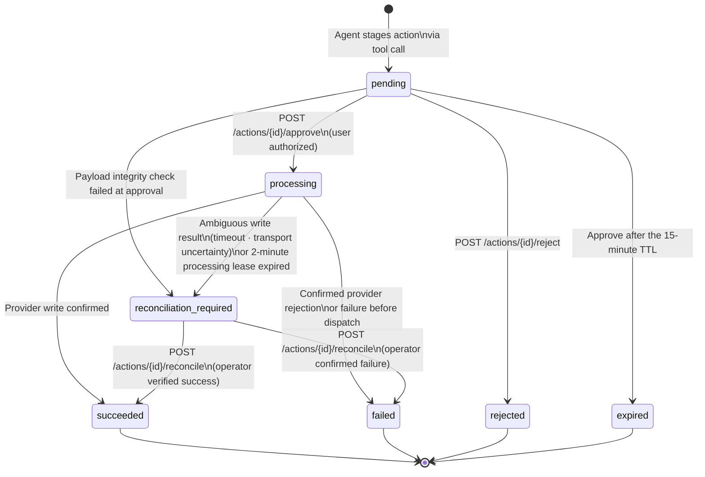

# API reference

HTTP and event-stream behavior **as built today**. The source of truth for request and response shapes is [`openapi.json`](openapi.json), which CI keeps in step with the code. Examples are abridged. The one-line table of every route is in [ARCHITECTURE.md](../.lock/ARCHITECTURE.md#4-api-surface-built); planned changes are in [TASKS.md](../.lock/TASKS.md).

All authenticated endpoints require an `Authorization: Bearer <JWT_TOKEN>` header with matching `JWT_ISSUER` and `JWT_AUDIENCE`.

## 1. Health, Liveness, and Readiness

```http
GET /livez HTTP/1.1
Host: localhost:8000
```
Returns `200 OK` if the process is up.

```http
GET /readyz HTTP/1.1
Host: localhost:8000
```
Returns `200 OK` if PostgreSQL is reachable and migrated to the latest Alembic revision, and (for the `api` and `combined` roles) Redis is responsive. In the `automation_worker` and `combined` roles it also requires a valid Gmail watch, a fresh worker heartbeat, idle recovery state, and no dead-lettered notification jobs. Otherwise it returns `503 Service Unavailable` with a machine-readable reason (`database_or_schema_unavailable`, `redis_unavailable`, `automation_watch_unavailable`, `automation_worker_stale`, or `automation_recovery_required`). Makes zero external Google API calls.

**Ready response (200 OK):**
```json
{
  "status": "ready",
  "reason": "ready"
}
```

**Example unready response (503 Service Unavailable):**
```json
{
  "status": "unready",
  "reason": "redis_unavailable"
}
```

## 2. Gmail Automation Diagnostics

```http
GET /mail/agent/health HTTP/1.1
Host: localhost:8000
Authorization: Bearer <JWT_TOKEN>
```
Reports automation health for the authorized global operator (the JWT subject must equal `AUTOMATION_OWNER_ID`). It returns `200 OK` with the health verdict in the `status` and `gmail_service_status` fields; both report healthy/ready only when a valid unexpired Gmail watch with no renewal error, a fresh worker heartbeat, idle recovery state, and no dead-lettered notification jobs all exist. The `detail` field names the first failing condition.

```http
GET /mail/agent/status HTTP/1.1
Host: localhost:8000
Authorization: Bearer <JWT_TOKEN>
```
Provides safe diagnostic telemetry on queue depths, lease states, and history resync status without exposing message content.

## 3. Interactive Executive Agent

Runs the tool-using Gemini agent for up to 5 turns. Calendar lookups run immediately; a send, reply, event, or task is staged as a pending action and the run stops with the action ID:

```http
POST /executive/ HTTP/1.1
Host: localhost:8000
Authorization: Bearer <JWT_TOKEN>
Content-Type: application/json

{
  "input": "Schedule a 45-minute sync with sarah@example.com tomorrow at 3pm to review roadmap items"
}
```

**Response (200 OK):**
```json
{
  "result": "Approval required. Approve action 9b1deb4d-3b7d-4bad-9bdd-2b0d7b3dcb6d to continue."
}
```

## 4. Agent Event Streaming (SSE)

Streams model text and structured events via Server-Sent Events (`text/event-stream`). The streaming agent cannot read mail; its only tools are `send_email` and `create_task`, and both stage a pending action:

```http
POST /generate-stream/ HTTP/1.1
Host: localhost:8000
Authorization: Bearer <JWT_TOKEN>
Content-Type: application/json

{
  "input": "Add a task to review the Q3 budget on Friday"
}
```

**SSE Stream Output:**
```
data: {"event": "token", "content": "Creating a task for the Q3 budget review."}

data: {"event": "tool_result", "content": "Approval required. Approve action 9b1deb4d-3b7d-4bad-9bdd-2b0d7b3dcb6d to continue."}

data: {"event": "done", "content": ""}
```

Event types are `token`, `tool_result`, `error`, and `done`. `error` frames also carry an `error_code` (for example `llm_timeout` or `tool_unavailable`), and the stream ends after `done` or `error`. Comment lines (`: heartbeat`) keep idle connections open.

## 5. Approve Pending Action

Executes a staged action after user verification:

```http
POST /actions/9b1deb4d-3b7d-4bad-9bdd-2b0d7b3dcb6d/approve HTTP/1.1
Host: localhost:8000
Authorization: Bearer <JWT_TOKEN>
```

**Response (200 OK, abridged):**
```json
{
  "id": "9b1deb4d-3b7d-4bad-9bdd-2b0d7b3dcb6d",
  "action_type": "create_event",
  "status": "succeeded",
  "summary": "Create event 'Roadmap review sync' from 2026-10-16T15:00:00-04:00 to 2026-10-16T15:45:00-04:00 with attendees sarah@example.com",
  "result": {
    "external_id": "ob3f1c9a0d7e2b4c6a8f0e1d3c5b7a9f2e4d6c8b0a",
    "provider": "calendar"
  },
  "attempt_count": 1
}
```

The full response schema is `PendingActionResponse` in [`docs/openapi.json`](openapi.json). If the action was not claimable (already processed, rejected, or expired), the endpoint returns its current state without dispatching again.

## 6. Reconcile Ambiguous Action

Authorized operators can investigate and resolve uncertain provider mutations:

```http
POST /actions/9b1deb4d-3b7d-4bad-9bdd-2b0d7b3dcb6d/reconcile HTTP/1.1
Host: localhost:8000
Authorization: Bearer <JWT_TOKEN>
```

**Response (200 OK, abridged):**
```json
{
  "id": "9b1deb4d-3b7d-4bad-9bdd-2b0d7b3dcb6d",
  "action_type": "create_event",
  "status": "succeeded",
  "result": {
    "external_id": "ob3f1c9a0d7e2b4c6a8f0e1d3c5b7a9f2e4d6c8b0a",
    "provider": "calendar"
  }
}
```

Reconciliation only looks up the deterministic provider marker; it never writes to the provider again. The lookup evidence is stored server-side with the action and its audit events and is not returned in the response. If the outcome is still unknown, the action stays `reconciliation_required` with an updated `reconciliation_reason`. The caller's user ID must be listed in `PENDING_ACTION_OPERATOR_IDS`.

## 7. List Your Actions

Lists the caller's own actions in one lifecycle status, newest first, as summaries. The owner always comes from the JWT; there is no `user_id` parameter. The `payload` (for example an email body) is not included: fetch one action with `GET /actions/{action_id}` to see it.

```http
GET /actions?status=pending&limit=20 HTTP/1.1
Host: localhost:8000
Authorization: Bearer <JWT_TOKEN>
```

**Response (200 OK, abridged):**
```json
{
  "actions": [
    {
      "id": "9b1deb4d-3b7d-4bad-9bdd-2b0d7b3dcb6d",
      "action_type": "create_event",
      "summary": "Create event 'Roadmap review sync' from 2026-10-16T15:00:00-04:00 to 2026-10-16T15:45:00-04:00 with attendees sarah@example.com",
      "status": "pending",
      "created_at": "2026-10-16T14:50:12.481516Z",
      "expires_at": "2026-10-16T15:05:12.481516Z",
      "is_expired": false
    }
  ],
  "next_page_token": null
}
```

- `status` is required and must be one of `pending`, `processing`, `succeeded`, `failed`, `rejected`, `expired`, or `reconciliation_required`. Anything else returns `422`.
- `limit` is 1-100 (default 20). When more actions exist, `next_page_token` is set; send it back as `page_token` to get the next page. It is `null` on the last page. Paging is keyset-based, so actions created between requests never cause duplicates or gaps. A malformed `page_token` returns `422`.
- A pending action expires 15 minutes after it is created. The worker marks never-approved proposals `expired` on its hourly cleanup pass, so for up to an hour a stored `pending` action can already be past its deadline: `is_expired: true` marks those. Listing never modifies any row.

## 8. Inbox Triage Results

Shows the signed-in user what the background worker did with their own incoming mail: one result per analyzed message, newest first. There is no `user_id` or mailbox parameter. The owner is the verified Google account connected to the caller's login, and a user with no connected account gets an empty list.

```http
GET /mail/triage?state=succeeded&limit=20 HTTP/1.1
Host: localhost:8000
Authorization: Bearer <JWT_TOKEN>
```

**Response (200 OK, abridged):**
```json
{
  "results": [
    {
      "id": "3f0c8f5e-6f1d-4a43-9d5e-0a6f6a6b8c11",
      "message_id": "18c4e7a2b9d01f3a",
      "state": "succeeded",
      "summary_preview": "Sarah asks to move Thursday's roadmap review to 3 PM and wants a reply by tomorrow.",
      "last_error_code": null,
      "created_at": "2026-10-16T14:50:12.481516Z",
      "processed_at": "2026-10-16T14:50:15.120044Z"
    }
  ],
  "next_page_token": null
}
```

- `state` is required: `succeeded` (summarized), `noop` (filtered out, for example no-reply or promotional mail, or the message was no longer in the mailbox), `dead_letter` (analysis gave up; `last_error_code` says why and never contains email content), or `processing`. Anything else returns `422`.
- `limit` is 1-100 (default 20), and `page_token` / `next_page_token` work as for actions. Results are ordered by creation time, newest first.
- List items carry only `summary_preview` (the first 280 characters). `GET /mail/triage/{triage_id}` returns the full `summary` (up to 4,000 characters) for one result; another user's id returns `404`.
- Summaries are written by a model from untrusted email content, so a sender can influence them. Clients must render them as plain text, never as HTML or markdown, and never auto-link them.
- Results are deleted 14 days after processing (`GMAIL_TRIAGE_RETENTION_DAYS`), so this is a recent-activity view, not an archive.

## Pending Action Lifecycle

Every external mutation (send email, create event, create task, send reply) follows this state machine. No external write is dispatched without an explicit `approve` call.


